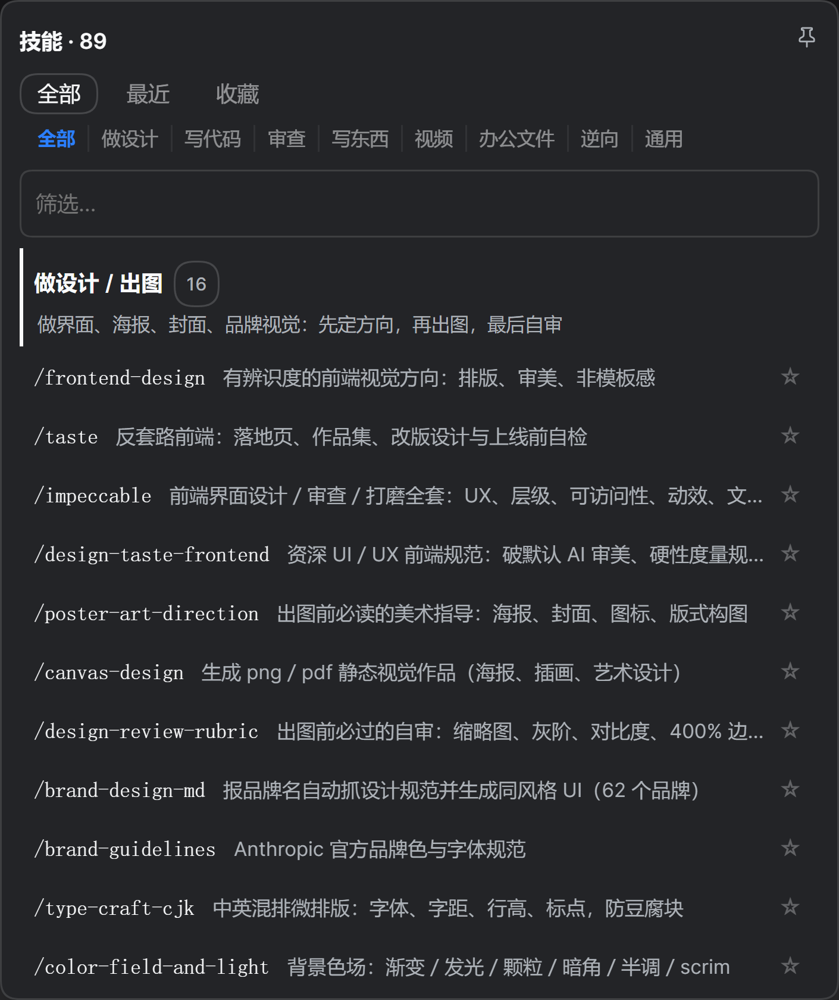
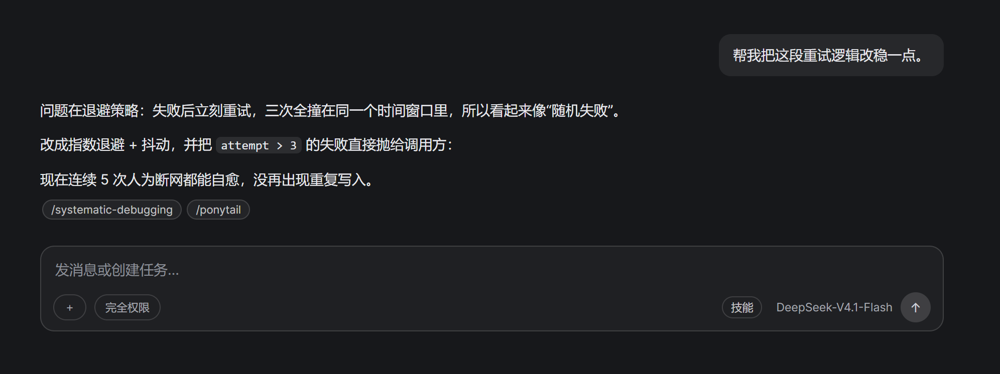
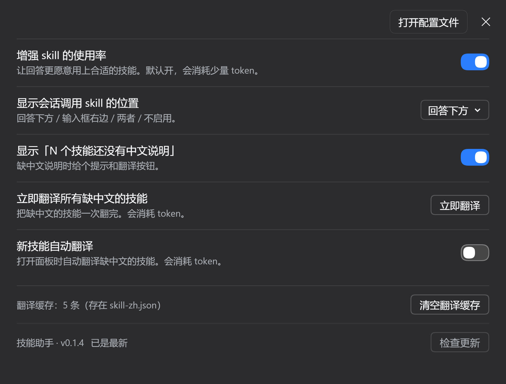

# 技能助手 · SkillMate

DSH 桌面端输入框旁边那颗「技能」按钮，单独做成一个插件：点开是全部技能的清单，按「我要做什么」分类，选一下就写进输入框。

包名 `dsh-skill-palette`，版本 `0.1.5`。







> 示例图用的是示意图内容，不含任何真实会话。

## 功能

- **按用途分类**：做设计 / 写代码 / 审查 / 写东西 / 视频 / 办公文件 / 逆向 / 通用，八个桶外加「其他」。分类是手写的表，新技能没归类时按名字和描述里的关键词自动进桶，一个都不中才落「其他」。
- **搜索**：名称、英文描述、中文说明、分类名都能匹配到。
- **最近使用**：用过的技能记 24 条，用一次顶到最前。
- **收藏**：每行右边 ☆ / ★，收藏页里每用一次自动置顶。
- **图钉**：钉住后点技能不收起面板，可以连着点几个；图钉未激活是灰色描边，激活是蓝色描边。
- **点一下就插进输入框**：写 `/技能名 ` 到光标处并自动补空格，DSH 会把它渲染成蓝色 chip。不走「复制到剪贴板」这种绕路。
- **回答下方显示这一轮用到的技能**：每条回答末尾一行小胶囊（如 `/systematic-debugging`），鼠标停上去看中文说明；一轮没用技能就不显示。
- **中文说明**：内置 90 个常用技能的中文一句话说明；装了新技能没有说明时，面板顶部会出现「N 个技能还没有中文说明」和一个「翻译 N 条」按钮，点一下用你「设置 → 模型」里选的默认模型翻，结果存在 `<dsh home>/skill-zh.json`，以后不再重复翻。
- **设置页**（设置 → 技能助手）：
  - 增强 skill 的使用率：在系统提示里加一段「先匹配技能再动手」，让回答更愿意调用合适的技能（默认开，约 90 token/次）。
  - 显示会话调用 skill 的位置：回答下方 / 输入框右边 / 两者 / 不启用（默认回答下方）。
  - 翻译相关的三行：缺中文提示、立即翻译所有缺中文的技能、新技能自动翻译；都能看到「会消耗 token」的提醒。
  - 最底部显示当前版本 + 「检查更新」。
- **只发公开元数据**：翻译只把技能名和英文描述发给模型，不发对话、不发文件、不记日志。

## 安装

```powershell
# npm
dsh plugin add dsh-skill-palette

# 从 GitHub 装
dsh plugin add github:AlLHHH/dsh-skill-palette
```

插件自己带 `cordis.patch.yml`，装进 profile 后会自动插一行 `skill-picker`，不需要手改配置。装完刷新页面（或在「应用菜单 → 重启应用」）即可。

## 怎么确认它在干活

1. 看输入框右边有没有「技能」按钮；点开标题是「技能 · N」，N 应该等于你装的技能总数（`~/.dsh/skills/*/SKILL.md` 加上技能包内置的入口）。
2. **新装技能会不会显示**：随便丢一个新目录进 `~/.dsh/skills/`，里面放一个 `SKILL.md`（frontmatter 至少要有 `name` 和 `description`），重新打开面板就应该多一行；面板开着时最多等 60 秒自己刷新。
3. **翻译能不能用**：新加的技能不在内置中文表里，面板顶部会出现「1 个技能还没有中文说明 / 翻译 1 条」。点它，几秒后那一行变成中文；`~/.dsh/skill-zh.json` 里会多一条记录，重启后依然有效。
   - 翻译走宿主路由 `POST /api/dsh-skill-palette/skill-zh`，用的是你已配好的默认模型，不需要另外填 key。
   - 失败会在按钮旁写出原因（例如「没有默认模型：先去『设置 → 模型』选一个」）。
4. **版本是不是最新**：设置页底部点「检查更新」，会去 registry 问 `latest` 标签，10 分钟内复用同一次结果。

## 兼容

- 需要 DSH `>= 0.2.0-0`；实测桌面版 `0.2.1-rc.3`。
- 客户端半边走 `window.__ModuleLoader__.load` + `slots` 座位 API（`conversation.input.right`、`settings.section`、`conversation.chat.turnTail`）。
- 宿主半边三条 `/api` 路由：翻译、增强开关、版本检查；依赖 `connection`、`llm`、`agentDefaultModel`、`systemPrompt` 服务，缺哪个都只是对应功能不可用，不会拖垮启动。

## 已知限制

- 中文说明表是手写的，新技能要么等按钮翻译、要么提 issue 补表。
- 翻译一次最多 40 条，客户端按 20 条一批串行发；模型返回非 JSON 时整批失败并提示。
- 分类规则是关键词猜的，个别技能可能落在不理想的桶里，可以在 issue 里说。
- 「检查更新」只读 registry，不会自动下载或安装。

## 许可证

MIT
